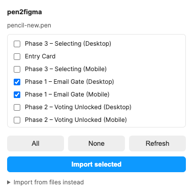
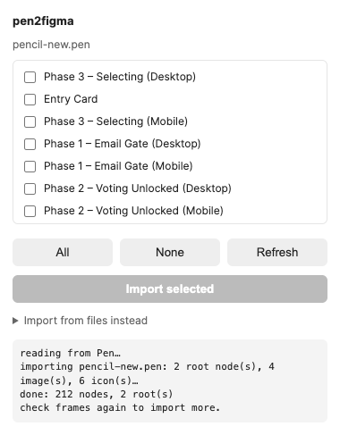
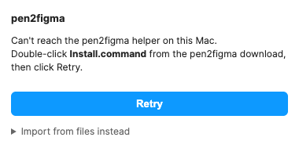

# pen2figma

Move [pen.dev](https://pen.dev) designs into Figma as real, editable Figma nodes: auto-layout frames, text, vectors, image fills, and color variables. No LLM in the loop, no tokens spent.

## What you need

- An Apple Silicon Mac (M1 or newer) with the **Pen** desktop app and the **Figma desktop app** (the plugin doesn't run in Figma in the browser).
- **Node.js**. If you don't have it, the installer opens [nodejs.org](https://nodejs.org/en/download). Download the **LTS** macOS installer, run it, then start the pen2figma install again.

## Install (once per Mac, about 2 minutes)

1. Download [pen2figma.zip](https://github.com/SheroCommerce/pen2figma-releases/archive/refs/heads/main.zip) and unzip it anywhere (Downloads is fine).
2. Open the unzipped folder and double-click **`Install.command`**. A Terminal window opens, runs for a few seconds and ends with *Done*.
   - If macOS says it *can't verify the developer*, click **Done** (not *Move to Bin*), open **System Settings → Privacy & Security**, scroll down, click **Open Anyway** next to *Install.command*, and confirm.
   - Or: open the Terminal app, type `bash ` (with a space), drag `Install.command` into the window, press Return.
3. The installer then opens a Finder window with **`manifest.json`** selected. In the Figma desktop app, open any file, then go to **Plugins → Development → Import plugin from manifest…** and drag that `manifest.json` into the dialog.

You can delete the downloaded folder afterwards. The installed copy lives in `~/Library/Application Support/pen2figma` and starts by itself when you log in.

## Use

1. Open your design in **Pen**. Optionally select the frames you want.
2. In **Figma**, open the file you want them in → **Plugins → Development → pen2figma**.
3. The plugin lists the frames of the Pen document. The ones you selected in Pen are already ticked (if you selected nothing, all are ticked). Adjust with the checkboxes, **All** or **None**.

   

4. Click **Import selected**. The frames show up in Figma with auto-layout, text styles, color variables, images and icons.

   When it's finished the log says *done* and all checkboxes clear, so you can't import the same frames twice by accident. Tick more frames to import again.

   

Changed the selection or opened another document in Pen? Click **Refresh**.

Frames land at the same position they have in Pen's canvas. Use an empty page or move them afterwards.

## Troubleshooting

| You see | Do this |
|---|---|
| *Can't reach the pen2figma helper* | Double-click `Install.command` again, then click **Retry**. |
| *Pen error: could not reach the Pen app* | Open Pen, then click **Refresh**. |
| *No document open in Pen* | Open a `.pen` file in Pen, then click **Refresh**. |
| Some text is in Inter instead of your font | The font isn't installed on your Mac (or in Figma). Install it and import again. The log lists which fonts were missing. |
| Grey boxes instead of images, or empty icons | Listed in the log. Send the log to whoever maintains pen2figma. |
| *helper … close and reopen the plugin* at the bottom | The helper was just updated. Close the plugin window and open it again. |
| *helper older - double-click Install.command again* at the bottom | Your copy is too old to update itself. Double-click `Install.command` from the newest download, once. |
| *update failed: …* in the log | Send the log to whoever maintains pen2figma. |
| No version at the bottom of the plugin, or an update didn't show up | Figma is loading an old copy. In Figma, remove pen2figma under **Plugins → Development → Manage plugins in development**, then import the `manifest.json` that `Install.command` shows in Finder again. |



Anything else: copy the text in the plugin's log box and send it along.

## Update or remove

- **Update:** click **Check for updates** at the bottom of the plugin window. If it offers **Update to v…**, click it, wait for *Updated*, then close and reopen the plugin. The bottom of the plugin window shows the version you're running.
- **Remove:** double-click `Uninstall.command`, then in Figma remove the plugin under **Plugins → Development → Manage plugins in development**.

---

## For developers

Two parts:

1. **Helper** (`bin/pen2figma.mjs serve`, Node): a tiny HTTP server on `http://localhost:4141` that talks to the Pen desktop app through its bundled MCP server, and returns the chosen nodes, image assets and icon SVGs. `Install.command` copies the repo to `~/Library/Application Support/pen2figma` and registers it as a launchd agent (`com.shero.pen2figma`, log `/tmp/pen2figma.log`).
2. **Figma plugin** (`plugin/`): a development plugin that lists the frames open in Pen and rebuilds the chosen ones as native Figma nodes.

**Shipping an update:** bump `version` in `package.json` and `VERSION` in `plugin/ui.html`, then merge to `main`. `.github/workflows/release.yml` sees the new version and mirrors the installable files to the public [`SheroCommerce/pen2figma-releases`](https://github.com/SheroCommerce/pen2figma-releases) (this repo stays private; it pushes with the `RELEASES_DEPLOY_KEY` secret, a write deploy key on that repo). *Check for updates* compares the installed version with `package.json` there and, when it's newer, downloads it into the installed copy, runs `npm install` and exits so launchd restarts the helper. A helper running from a git clone refuses to update itself.

Working from a clone instead: `npm install`, then `node bin/pen2figma.mjs install` (points launchd at the clone) or `node bin/pen2figma.mjs serve` in the foreground. `node bin/pen2figma.mjs uninstall` removes the launchd agent.

### Without the helper

`node bin/pen2figma.mjs export` writes `out/<doc>/design.json` and `out/<doc>/assets/` (flags: `--doc <file.pen>`, `--out <dir>`, `--no-icons`, or explicit node ids). In the plugin, expand **Import from files instead**, pick `design.json` and the `assets` folder.

### What maps

| pen.dev | Figma |
|---|---|
| `frame` with `layout` | auto-layout frame; `gap`, `padding`, `justifyContent`, `alignItems`, `wrap` |
| `frame` with `layout: "none"` | plain frame, children absolutely positioned |
| `width`/`height` number · `fill_container` · `fit_content` | FIXED · FILL · HUG |
| `layoutPosition: "absolute"` | absolute positioning inside auto-layout |
| `text` (`textGrowth`, `lineHeight`, `letterSpacing`, `textAlign`) | text node with matching auto-resize |
| `fontFamily` / `fontWeight` / `fontStyle` | nearest available style, checked against `listAvailableFontsAsync` |
| `$color` variables | color variables in collection `pen.dev/<doc>`, bound on fills and strokes |
| `$number` / `$string` variables | resolved to values |
| solid, gradient (linear/radial), image fills, multiple fill layers | same, in order |
| `stroke`, `strokeWidth` (number or per-side) | strokes with per-side weights |
| `icon` (lucide, phosphor, tabler, feather) | vector from the icon's SVG |
| `path` with geometry | vector |
| `rectangle`, `ellipse`, `line`, `group` | same |
| `reusable: true` | component |

### Known gaps

- **Instances are flattened.** Pen `ref` nodes are exported with `resolveInstances: true`, so instances become plain frames rather than Figma instances of the component.
- **Fonts must be visible to Figma.** Google Fonts always are. Local fonts need the Figma font helper. Missing fonts fall back to Inter and are listed in the import log.
- **Image fills over 4096px** on a side are downscaled by Figma on import.
- **Not supported:** Pen browser nodes, scripts, shaders, `Generate` prompts, effects/shadows. They import as empty frames and are listed in the log.
- Height can drift a pixel or two per bordered frame because strokes are set to INSIDE.

### Layout

```
Install.command     double-click installer: copies to ~/Library/Application Support, npm install, launchd
Uninstall.command   removes the launchd agent and the installed copy
bin/pen2figma.mjs   CLI: serve (helper), export, install/uninstall (launchd)
lib/pen.mjs         Pen MCP client + design.json builder, shared by serve and export
plugin/manifest.json
plugin/code.js      converter, runs in the Figma plugin sandbox
plugin/ui.html      frame picker (talks to the helper) + file-picker fallback + log
icons/<lib>/*.svg   bundled fallback icons; fetched icons are cached in ~/.pen2figma/icons
docs/screenshots/   README images
out/                export output (gitignored)
```
